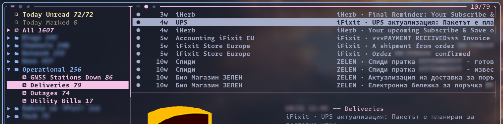
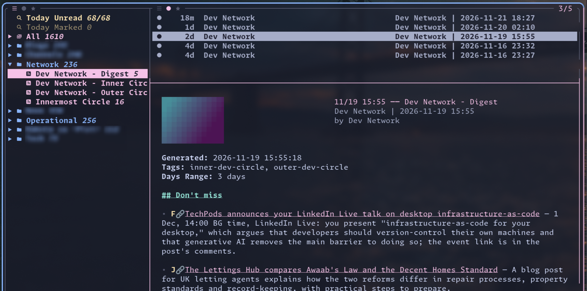
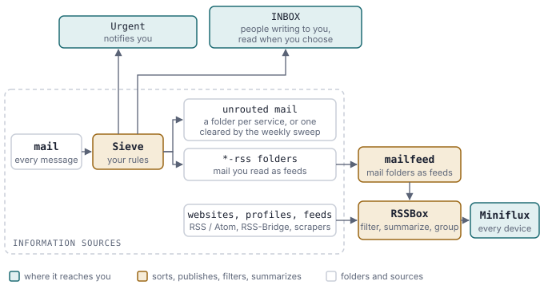
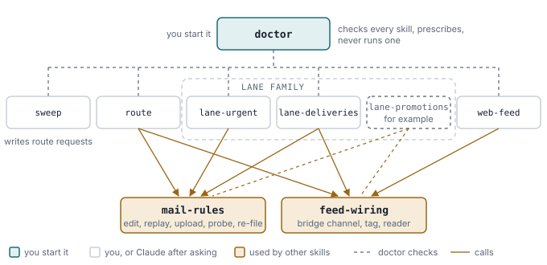

# svetovid

[](https://github.com/thewebmasterp/svetovid)
[](LICENSE)
<!-- Put these two back between Status and License once contributions start coming in:
[](https://github.com/thewebmasterp/svetovid/issues)
[](https://github.com/thewebmasterp/svetovid/pulls)
-->

## Introduction

Most of what reaches you is noise, and what matters drowns in it. **svetovid
pulls the two apart: it's a repository of Claude Code skills that help you build
an RSS system on steroids, with your mail plugged in.**

Under the hood, Claude sets up and maintains
[Sieve](https://en.wikipedia.org/wiki/Sieve_(mail_filtering_language)) rules
that decide where each mail goes, and a feed pipeline that turns mail,
websites and profiles into one reader:

1. **Sources**: a mail folder (published as a feed by
   [mailfeed](https://github.com/thewebmasterp/mailfeed)), an
   [RSS/Atom feed](https://en.wikipedia.org/wiki/Web_feed), or a scraped
   webpage, such as a LinkedIn profile, via
   [RSS-Bridge](https://github.com/RSS-Bridge/rss-bridge) or a custom scraper.
2. **Refining** ([RSSBox](https://github.com/versun/RSSBox)): each source can
   be filtered and summarized, then grouped into a tag with other sources, and
   the tag filtered and summarized as a whole, or compiled into a digest.
3. **Reading** ([Miniflux](https://github.com/miniflux/v2)): subscribe to the
   tags holding the refined information, in one account that all your devices
   log into, with the client of your choice (I use
   [eilmeldung](https://github.com/christo-auer/eilmeldung)) or Miniflux's own
   web UI.

<p>
  
  <br>
  <sub>Every order from every shop in one feed: confirmations, payments, shipping and delivery updates.</sub>
</p>

<br>

<p>
  
  <br>
  <sub>What my dev network posted on LinkedIn, without the algorithmically curated feed and its ad after every third post. Don't want to read it all? A digest written from my own prompt sums up what matters to me.</sub>
</p>

## Features

- **You choose what may steal your attention.** Login codes and failed
  payments notify you right away. Mail that can wait, waits.
- **Categories of mail become feeds.** The skills go through your mail with
  you, find its categories (delivery updates, bills, newsletters) and write
  filters for the ones you want as feeds. Mail you already have is moved
  there too, and everything new follows.
- **Websites without RSS become feeds.** A job board, a changelog page, a
  company blog: scraped, then filtered by AI down to what you care about.
- **Follow people, not platforms.** All posts from the profiles you pick arrive in
  your reader, ordered chronologically.
- **Configure each platform's notification policy.** A skill will interrogate
  you and use your browser to set a platform's email notification preferences.
  Every kind of email you keep then lands where you decided: Urgent, which
  notifies you, your INBOX, or an RSS feed. Whatever the rules don't recognize
  waits for the weekly sweep.
- **Weekly sweep.** New services you sign up to mean new mail your filters
  don't know yet. Once a week, a skill reviews it with you, marks it read,
  passes the rules you approve on to the route skill to build, and remembers
  your answers so it never asks twice.

## Architecture



## Installation

You need a mail provider that runs Sieve, a local copy of your mail, and Linux
with Python 3.11 or newer; [STACK.md](STACK.md#what-you-must-have) has the
details.

1. **Install the skills:**

   ```text
   /plugin marketplace add thewebmasterp/svetovid
   /plugin install svetovid@svetovid
   ```

2. **Run `/svetovid:doctor`.** It asks what you run today, writes your config,
   and writes `build-plan.md`: a prompt listing the parts you still need, with
   the constraints from [STACK.md](STACK.md). It doesn't build anything. If
   your mail is on Gmail or Outlook, it stops here and tells you how to forward
   it to a provider that runs Sieve.
3. **In a new session, have your agent build the plan:** "build what's in
   `~/.config/svetovid/doctor/build-plan.md`".
4. **Run `/svetovid:doctor` again.** It checks what you built. Repeat steps 3
   and 4 until every check passes.

## Skills



A **lane** pulls one kind of mail out of every service and sends it to one
place: lane-urgent to the Urgent folder, lane-deliveries to the Deliveries
feed. Every lane works the same way: it detects its kind of mail, asks you per
service (a no is remembered), writes the rules, and catches what they missed.

| Skill | Call it when | What it does |
|---|---|---|
| **doctor** | you're setting up, or want to know what needs attention | checks every part and every skill, then tells you which skill to run and why |
| **sweep** | it's been a week, or mail that slipped past your filters has piled up and needs clearing | walks you through leftover mail, remembers your answers, hands approved routes to route |
| **route** | a service sends mail you want handled differently ("next, GitHub") | triages its mail, switches off unwanted notifications in its settings, writes the rules, sets up feeds |
| **lane-urgent** | something should have notified you and didn't, or did and shouldn't have | tunes what reaches Urgent, tested on your whole archive |
| **lane-deliveries** | you ordered from a new shop, or an order update is missing | wires the shop into the Deliveries feed |
| **web-feed** | you want a site with no feed in your reader, or a feed stopped updating | builds a feed from the site and adds it under a topic |
| **mail-rules**, **feed-wiring** | never: the skills above call them | change your Sieve rules safely; publish feeds |

What doctor tells you looks like this:

```text
Prescriptions
  1. sweep            143 unread service mails, the oldest from 9 days ago
  2. lane-deliveries  new folder "exampleshop" holds 3 order mails
  3. web-feed         [Jobs] Example Board: silent 6 days, usually posts every day
```

Your config, decisions and state live in `~/.config/svetovid`. Nothing
personal lives in this repo.

**Why the name.** Svetovid, a Slavic god whose name reads as "world-seer". The
system keeps watch on the world for you: your mail, the sites you follow, your
own services.

## Contributing

Contributions are welcome: open an issue or a pull request. Before proposing a
new skill, read [SCOPE.md](SCOPE.md) and the ideas already turned down in
[decided/](decided/).

To work on the skills, clone the repo and run `scripts/link-skills.sh`: it
links every skill into `~/.claude/skills`, so what you edit is what you use.

## License

MIT
